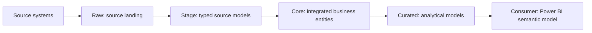

# Databricks Target

Build a metadata-driven lakehouse on Databricks: source ingestion, layered Delta
tables, transformation notebooks and jobs that create and load those tables.
Instead of writing each notebook and job definition by hand, describe entities,
sources, transformations and operational properties in the model and generate
the corresponding artifacts.

## What you can build

The target supplies the Databricks part of a layered data platform. The
[Power BI target](../powerbi-tabular/README.md) adds its consumer semantic model.



This is the sample's intended data flow. The actual notebook dependencies follow
the sources and transformations you model.

| Layer | Role in the solution | Generated Databricks artifacts |
| --- | --- | --- |
| Raw | Land data from external sources before applying the modeled business structure. Raw tables are derived from source metadata. | Table-definition and extraction notebooks, including full/delta extraction behavior selected by source properties |
| Stage | Represent source entities with the modeled columns, types and mappings. | DDL notebooks and DML notebooks that process Raw data |
| Core | Integrate data into reusable business entities and apply business transformations. | DDL and DML notebooks, plus referenced transformation scripts |
| Curated | Prepare analytical entities for consumption, such as dimensions and facts. | DDL and DML notebooks for the modeled analytical tables |

Layer definitions live in [Base/Zones.json](../../Base/Zones.json). Notebook
directories follow each zone's local folder, with product and module folders
preserved beneath it. The sample uses `010-Stage`, `020-Core` and `030-Curated`;
Raw notebooks are derived from the external sources.

## Notebooks and table behavior

- **DDL notebooks** define Delta tables from entity attributes and their metadata,
  including comments, tags and history-related columns where configured. Their
  `Generated CREATE TABLE statement` cell contains the complete SQL rendered
  from the model, so users can review the table definition before it runs. The
  selected catalog is substituted at runtime because it comes from the bundle
  environment; the notebook prints the exact SQL it executes.
- **Raw extraction notebooks** read the modeled external sources and write the
  landing tables. Source properties select extraction and write behavior.
- **DML notebooks** apply mappings and transformations, then write the modeled
  tables. Entity settings select overwrite, append or business-key merge behavior;
  configured SCD0/SCD1/SCD2 attributes shape the history logic.
- **Transformation scripts** referenced by model functions are copied alongside
  their entity's DML notebook.

For example, a Stage Customer with an external source produces Raw ingestion
artifacts and Customer table-definition/load notebooks. Modeled downstream Core
and Curated entities extend that chain with their own notebooks. Changing the
model or shared templates lets you regenerate the affected platform artifacts.

## Jobs and orchestration

The target generates Databricks job definitions for both initial table setup and
recurring data loads:

| Job | Purpose |
| --- | --- |
| **Create All** | Invoke one creation job per zone in modeled layer dependency order |
| **Zone creation jobs** | Run all DDL notebooks for that zone as parallel tasks |
| **Load jobs** | Generate exactly one job per distinct modeled `jobs` value. Each job contains its assigned entities across all layers, extracts required Raw sources, and runs DML notebooks according to modeled dependencies. |

Each load job starts with `Start_Load`, runs its extraction and entity tasks, and
finishes with `Complete_Load`. Source references become task dependencies;
relationships used by `lookup_dimensions` also gate the dependent entity task.
Cross-job dependencies remain in the generated execution manifest. A load job
does not start another model job or process its entities; it reads the existing
upstream data. The local and CI integration runner runs every selected model
job once in dependency order and stops before downstream jobs if a prerequisite
fails. A manually started downstream job expects its upstream data to be current.
Schedule and compute settings come from the modeled job values and bundle
configuration.

## Generated layout

The target is selected as **databricks**. Its configured output root is
`Output/databricks-lake/generated`; payloads write notebooks and bundle YAML
beneath it:

```text
Output/databricks-lake/
  databricks.yml                         # Maintained bundle entry point
  utils/                                 # Shared runtime notebooks/frameworks
  generated/
    notebooks/<zone>/ddl/<product>/<module>/<entity>.py
    notebooks/<zone>/dml/<product>/<module>/<entity>.py
    schemas/schema.yml
    clusters/clusters.yml
    jobs/create_all_tables.yml
    jobs/<zone>/Create_<zone>.yml          # One parallel DDL task group per zone
    jobs/load_<jobs-value>.yml
```

The sample therefore generates `load_sales_daily.yml` and
`load_sales_weekly.yml`, not separate load jobs for each layer. See the
[property reference](PROPERTIES.md) for configuring job
assignments and the other target-specific properties.

The exact notebook subdirectories follow the model's folder hierarchy. Cluster
settings are emitted when cluster metadata is configured. The existing
[bundle entry point](../../Output/databricks-lake/databricks.yml) includes the
generated resources and the shared `utils` directory. Maintain those deployment
files alongside the generated output. See [deployment and integration](DEPLOYMENT.md)
for the configured test environments and local run command.

## Generate and use the result

Use **DataM8 app 2.0.0**, select **databricks** in the generator and choose
**Generate**. Or run **DataM8 CLI 2.0.0** from the solution root:

```sh
datam8 generate databricks --solution ./ORAYLISDatabricksSample.dm8s
```

Review the notebooks, job graphs and generated paths. Configure your workspace,
catalog, storage, identities and secrets in the bundle and runtime settings, then
deploy through your Databricks release process. In the workspace, use the creation
jobs to establish the tables and the load jobs to execute the data flow.

For setup, see [getting started](../../docs/getting-started.md) and
[deployment preparation](../../docs/quickstart.md). For payload contracts,
template mappings and implementation changes, read [ARCHITECTURE.md](ARCHITECTURE.md).
